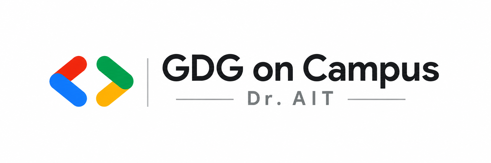
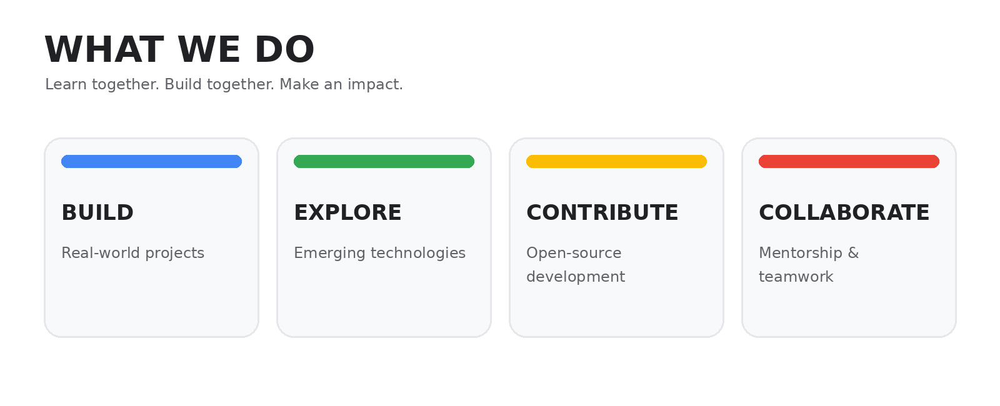

# Namaste, Developers! 🙏

  

<h2 align="center">Welcome to GDG on Campus – Dr. AIT!</h2>

  <b>Where ideas meet innovation, and developers build together.</b>

We are a developer community at **Dr. Ambedkar Institute of Technology, Bengaluru**, bringing together passionate minds to explore technology, build real-world projects, and contribute to open source.

Our goal is to create an ecosystem where everyone can learn, collaborate, share knowledge, and turn ideas into meaningful solutions.

---

## 🚀 What We Do

  

- **Build:** Create real-world projects and practical solutions.
- **Explore:** Learn emerging technologies and developer tools.
- **Contribute:** Participate in open-source development.
- **Collaborate:** Connect with developers, seniors, alumni, and mentors.
- **Grow:** Share knowledge and develop technical skills.

## 💻 Explore Our Domains

| Domain | Focus |
|---|---|
| AI / ML | Artificial Intelligence and Machine Learning |
| Web Development | Frontend and Backend Engineering |
| App Development | Android and Cross-platform Apps |
| Cloud & DevOps | Cloud Infrastructure and Automation |
| DSA | Problem Solving and Algorithms |
| Open Source | Community-driven Development |

## 🌱 Get Involved

Whether you're a beginner or an experienced developer, there's always something to build together.

1. Explore our repositories.
2. Find projects that interest you.
3. Check contribution guidelines.
4. Start contributing.
5. Collaborate and grow with the community.

## 🤝 Join the Community

Have an idea? Let's build it.  
Have experience? Share it.  
Want to contribute? You're welcome here.

  <b>Learn. Build. Collaborate. Contribute.</b>

  <a href="https://github.com/gdg-on-campus-drait">
    <b>⭐ Follow our GitHub Organization</b>
  </a>

---

  Made with ❤️ by the GDG on Campus – Dr. AIT Community.

